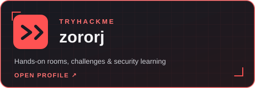
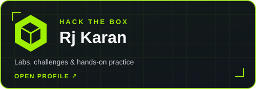

  

  

<h1 align="center">Karan RJ</h1>

  🏴‍☠️ Security · Code · CTFs

  <a href="https://www.linkedin.com/in/zororj/">LinkedIn</a> &nbsp;·&nbsp;
  <a href="mailto:rjkaran418@gmail.com">Email</a> &nbsp;·&nbsp;
  <a href="https://rj-karan.github.io/zoroStack/">Website</a>

---

<h2 align="center">Where I practice</h2>

Problem solving, security labs, and CTF challenges.

<h3 align="center">01 / LeetCode</h3>

  

<h3 align="center">02 / TryHackMe</h3>

  

<h3 align="center">03 / Hack The Box</h3>

  

