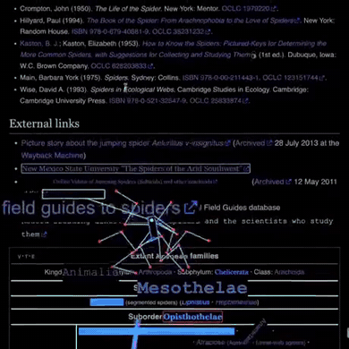
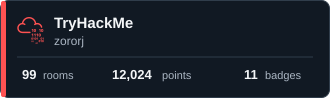

  

 

<h1 align="center">Yooo, I'm Karan 👋</h1>

Security · Code · CTFs

 

---

<h3>⚔️ About me</h3>

<table align="center" width="100%">
  <tr>
    <td width="40%" align="center" valign="middle">
      
    </td>
    <td width="60%" valign="middle">
      
<strong>Hey, I'm Karan RJ.</strong>

      
I'm a B.Tech CSE (Cybersecurity) student at Sri Shakthi IET in Coimbatore. I build secure full-stack systems and purple-team tools.

      
I work across security research, DevSecOps and CTFs, bringing offensive and defensive thinking into the same workflow.

      
<strong>Tech stack</strong> 
      Python · FastAPI · React · TypeScript · MySQL 
      Docker · Kali Linux · Burp Suite · AWS · Git

      
<a href="https://rj-karan.github.io/zoroStack/">Website</a> ·
      <a href="https://www.linkedin.com/in/zororj/">LinkedIn</a> ·
      <a href="mailto:rjkaran418@gmail.com">Email</a>

    </td>
  </tr>
</table>

---

<h2 align="center">Where I practice</h2>

<h3 align="center">
   LeetCode
</h3>

  
  

  

---

<h3 align="center">
   TryHackMe
</h3>

  

  Profile stats checked on 26 October 2026

---

<h3 align="center">
   Hack The Box
</h3>

  

  <a href="https://profile.hackthebox.com/profile/019c8e6f-d9bc-7154-9912-4294960a0296">View my full HTB profile</a> &nbsp;·&nbsp; 6 earned badges and 1 CTF participation certificate

